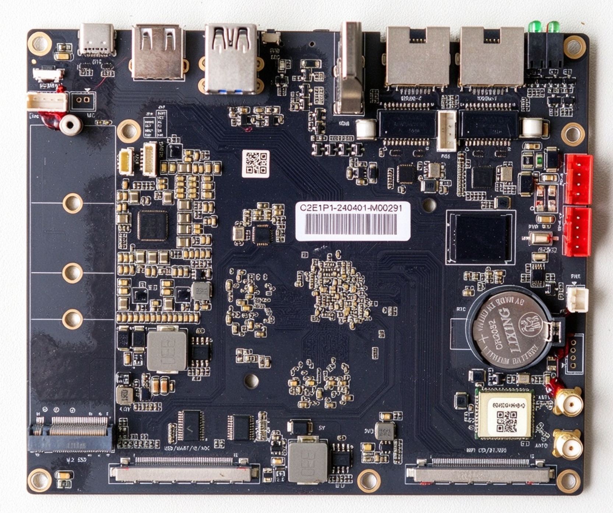
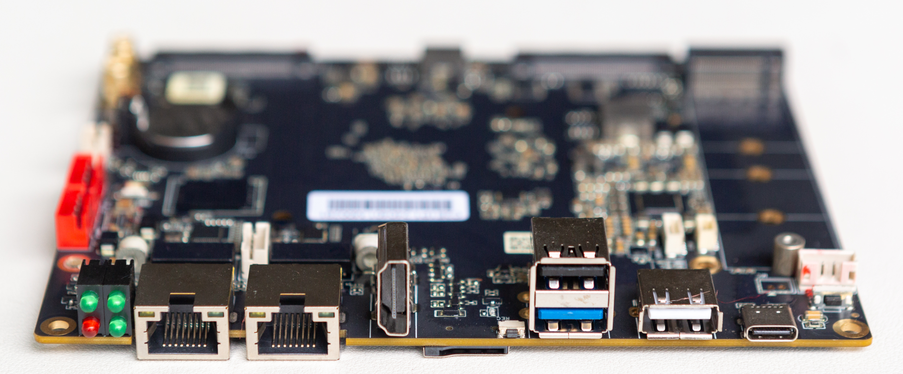
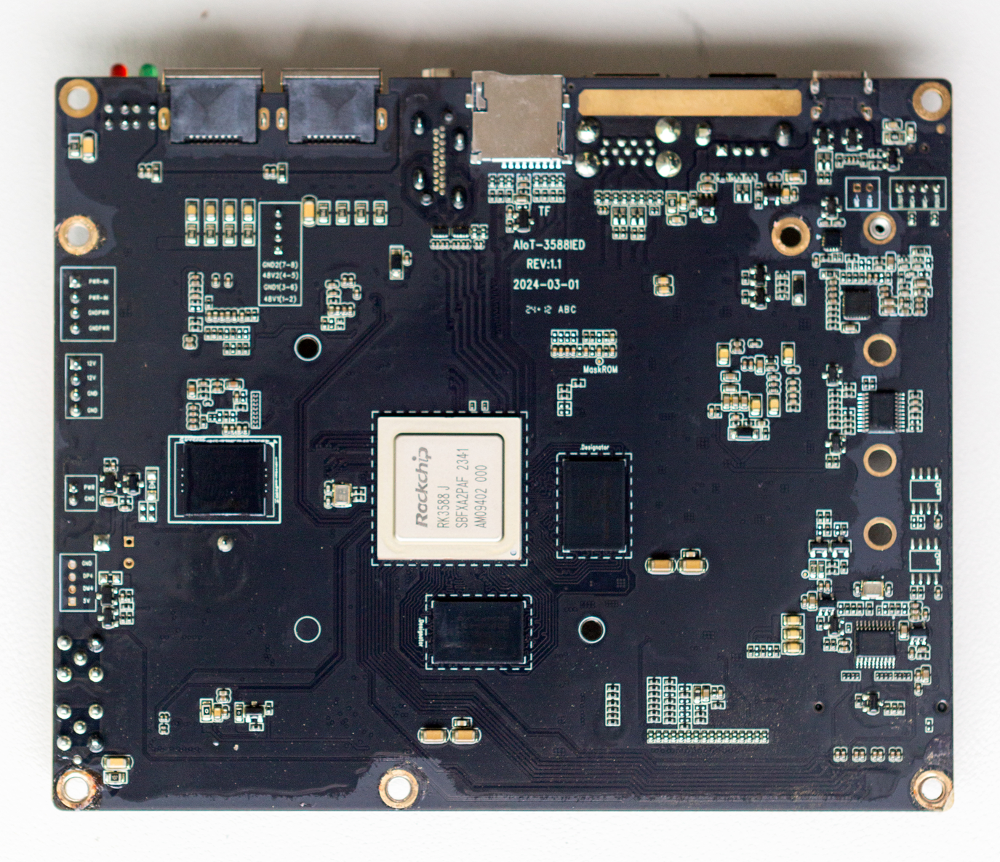
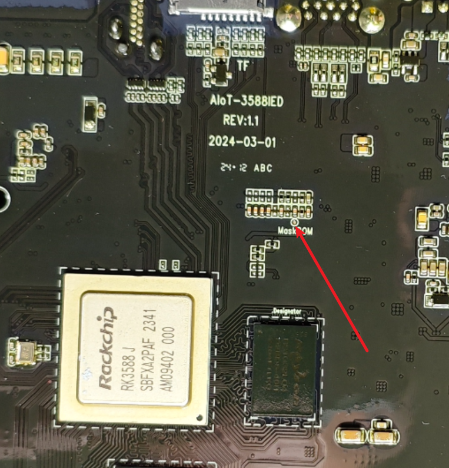
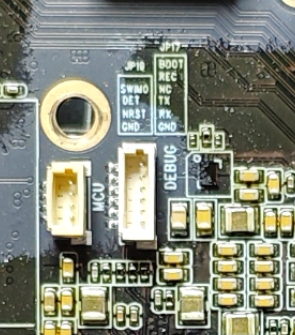

# 视美泰AIoT-3588IED适配








## 目录

* [硬件规格](docs/硬件规格.md)
* [固件列表](docs/固件列表.md)
* [刷机指引](docs/刷机指引.md)
  * [ophub armbian](docs/刷机指引/ophub_armbian.md)
  * [ophub 飞牛](docs/刷机指引/ophub_fnos.md)
  * [ophub openwrt](docs/刷机指引/ophub_openwrt.md)
  * [android12固件](docs/刷机指引/android12.md)
  * [android13固件](docs/刷机指引/android13.md)
  * [android14固件](docs/刷机指引/android14.md)
* [适配记录](docs/适配记录.md)
  * [uboot v2017](docs/适配记录/uboot2017.md)
  * [uboot v2026](docs/适配记录/uboot2026.md)
  * [recovery](docs/适配记录/recovery.md)
  * [ophub 6.18.y](docs/适配记录/ophub_6.18.y.md)
  * [ophub 6.6.y](docs/适配记录/ophub_6.6.y.md)
  * [ophub 6.1.y](docs/适配记录/ophub_6.1.y.md)
  * [rockchip-linux develop-6.12](docs/适配记录/rockchip-linux_develop-6.12.md)
  * [linux-stable](docs/适配记录/linux-stable.md)
  * [android12适配](docs/适配记录/android/android12.md)
  * [android13适配](docs/适配记录/android/android13.md)
  * [android14适配](docs/适配记录/android/android14.md)
  * [edk2 uefi适配](docs/适配记录/edk2_uefi.md)
* [外壳机箱](docs/外壳机箱.md)
* [需求清单](docs/需求清单.md)


## 参数规格


## 相关链接


## maskrom短接点、TTL、硬盘电源

- maskrom短接点：

在CPU旁边，将MASKROM点位于TF卡铁壳表面短接即可



- debug调试口

* 调试口在主板正面，有丝印。仅需要连接GND、RX、TX三根连线即可，其余不用接。接口规格是SH1.0mm 6pin，建议购买转杜邦线头的版本。
* 调试口需要配置USB转TTL模块（单独购买），建议选择CH340 （通用款即可，没有特殊要求）




## 适配进度

### 仓库结构

* 适配采用多仓库体系：**每个内核对应一个独立的适配仓库**，各自构建**内核镜像、uboot 镜像**并发布到自己的 GitHub Release（内核产物含 `Image` / `config` / `System.map` / `dtb` / `kos` 等）；
* home 仓库 `aiot-3588ied` 负责**封装 rootfs（ rootfs 产物仓库：[yifengyou/kdev](https://github.com/yifengyou/kdev) ）构建完整的 img**，发布到本仓库 Release。

```
适配仓库体系（github.com/yifengyou）
│
├── aiot-3588ied                ★ home 仓库：封装 rootfs → 完整 img，适配文档中心
│
├── 内核适配仓库（每个内核一个仓库，产出内核镜像）
│   ├── rockchip-ophub-linux-6.18.y       ophub 6.18.y 内核（含 recovery 内核）
│   ├── rockchip-ophub-linux-6.12.y       ophub 6.12.y 内核
│   ├── rockchip-ophub-linux-6.6.y        ophub 6.6.y 内核
│   ├── rockchip-ophub-linux-6.1.y        ophub 6.1.y 内核
│   ├── rockchip-kernel                   rockchip develop-6.1 / 6.6 / 6.12 内核
│   ├── rockchip-linux-stable             linux-stable 内核
│   ├── rockchip-openanolis               AnolisOS devel-6.6 内核
│   ├── rockchip-opencloudos              OpenCloudOS linux-6.6 内核
│   └── rockchip-openeuler                openEuler OLK-6.6 内核
│
├── rockchip-uboot-mainline      uboot 适配仓库：uboot 镜像
├── rockchip-khadas-android14    android14 适配仓库：uboot / kernel / 固件 / 刷机底包
│
└── kdev                         rootfs 产物仓库（home 仓库打包 img 的素材来源）
```

### uboot

| 上游 / 分支 | 适配仓库 | 构建产物下载 | 适配进度 |
| :--- | :--- | :--- | :--- |
| [u-boot/u-boot](https://github.com/u-boot/u-boot) `main` | [rockchip-uboot-mainline](https://github.com/yifengyou/rockchip-uboot-mainline) | [aiot-3588ied-uboot](https://github.com/yifengyou/rockchip-uboot-mainline/releases/tag/aiot-3588ied-uboot) | ✅ 已完成 |

### 内核与完整镜像

完整镜像（img）在本仓库封装 rootfs 后发布，每个镜像 Release 包含上百个 rootfs 变体（armbian / debian / ubuntu / openwrt / istoreos / openeuler / opencloudos / openanolis / kali / fedora / rockylinux / centos / 飞牛 fnos 等各版本）。

| 上游 / 分支 | 适配仓库 | 内核产物下载 | 完整镜像(img)下载 | 适配进度 | 
| :--- | :--- | :--- | :--- | :--- |
| [linux-stable](https://mirrors.cernet.edu.cn/linux-stable.git) `master` | [rockchip-linux-stable](https://github.com/yifengyou/rockchip-linux-stable) | [aiot-3588ied](https://github.com/yifengyou/rockchip-linux-stable/releases/tag/aiot-3588ied) | [linux-stable](https://github.com/yifengyou/aiot-3588ied/releases/tag/linux-stable) | ✅ 已完成 | 
| [ophub/linux-6.18.y](https://github.com/ophub/linux-6.18.y.git) `ophub_6.18.y` | [rockchip-ophub-linux-6.18.y](https://github.com/yifengyou/rockchip-ophub-linux-6.18.y) | [aiot-3588ied](https://github.com/yifengyou/rockchip-ophub-linux-6.18.y/releases/tag/aiot-3588ied) · [aiot-3588ied-recovery](https://github.com/yifengyou/rockchip-ophub-linux-6.18.y/releases/tag/aiot-3588ied-recovery) | [ophub_6.18.y](https://github.com/yifengyou/aiot-3588ied/releases/tag/ophub_6.18.y) | ✅ 已完成 | 
| [rockchip-linux/kernel](https://github.com/rockchip-linux/kernel.git) `develop-6.12` | [rockchip-kernel](https://github.com/yifengyou/rockchip-kernel) | [aiot-3588ied_develop-6.12](https://github.com/yifengyou/rockchip-kernel/releases/tag/aiot-3588ied_develop-6.12) | [rockchip_develop-6.12](https://github.com/yifengyou/aiot-3588ied/releases/tag/rockchip_develop-6.12) | ✅ 已完成 |
| [rockchip-linux/kernel](https://github.com/rockchip-linux/kernel.git) `develop-6.6` | [rockchip-kernel](https://github.com/yifengyou/rockchip-kernel) | [aiot-3588ied_develop-6.6](https://github.com/yifengyou/rockchip-kernel/releases/tag/aiot-3588ied_develop-6.6) | [rockchip_develop-6.6](https://github.com/yifengyou/aiot-3588ied/releases/tag/rockchip_develop-6.6) | ✅ 已完成 |
| [rockchip-linux/kernel](https://github.com/rockchip-linux/kernel.git) `develop-6.1` | [rockchip-kernel](https://github.com/yifengyou/rockchip-kernel) | [aiot-3588ied_develop-6.1](https://github.com/yifengyou/rockchip-kernel/releases/tag/aiot-3588ied_develop-6.1) | [rockchip_develop-6.1](https://github.com/yifengyou/aiot-3588ied/releases/tag/rockchip_develop-6.1) | ✅ 已完成 |
| [anolis/cloud-kernel](https://gitee.com/anolis/cloud-kernel) `devel-6.6` | [rockchip-openanolis](https://github.com/yifengyou/rockchip-openanolis) | [aiot-3588ied_devel-6.6](https://github.com/yifengyou/rockchip-openanolis/releases/tag/aiot-3588ied_devel-6.6) | [openanolis_devel-6.6](https://github.com/yifengyou/aiot-3588ied/releases/tag/openanolis_devel-6.6) | ✅ 已完成 |
| [openeuler/kernel](https://atomgit.com/openeuler/kernel) `OLK-6.6` | [rockchip-openeuler](https://github.com/yifengyou/rockchip-openeuler) | [aiot-3588ied_OLK-6.6](https://github.com/yifengyou/rockchip-openeuler/releases/tag/aiot-3588ied_OLK-6.6) | [openeuler_olk-6.6](https://github.com/yifengyou/aiot-3588ied/releases/tag/openeuler_olk-6.6) | ✅ 已完成 |
| [OpenCloudOS/OpenCloudOS-Kernel](https://gitee.com/OpenCloudOS/OpenCloudOS-Kernel) `linux-6.6` | [rockchip-opencloudos](https://github.com/yifengyou/rockchip-opencloudos) | [aiot-3588ied_linux-6.6](https://github.com/yifengyou/rockchip-opencloudos/releases/tag/aiot-3588ied_linux-6.6) | [opencloudos_linux-6.6](https://github.com/yifengyou/aiot-3588ied/releases/tag/opencloudos_linux-6.6) | ✅ 已完成 |
| [ophub/ophub_6.1.y](https://github.com/ophub/ophub_6.1.y) `master` | [rockchip-ophub-linux-6.1.y](https://github.com/yifengyou/rockchip-ophub-linux-6.1.y) | [aiot-3588ied_ophub-6.1.y](https://github.com/yifengyou/rockchip-ophub-linux-6.1.y/releases/tag/aiot-3588ied_ophub-6.1.y) | [ophub_6.1.y](https://github.com/yifengyou/aiot-3588ied/releases/tag/ophub_6.1.y) | ✅ 已完成 |
| [ophub/ophub_6.6.y](https://github.com/ophub/ophub_6.6.y) `master` | [rockchip-ophub-linux-6.6.y](https://github.com/yifengyou/rockchip-ophub-linux-6.6.y) | [aiot-3588ied_ophub-6.6.y](https://github.com/yifengyou/rockchip-ophub-linux-6.6.y/releases/tag/aiot-3588ied_ophub-6.6.y) | [ophub_6.6.y](https://github.com/yifengyou/aiot-3588ied/releases/tag/ophub_6.6.y) | ✅ 已完成 |
| [ophub/ophub_6.12.y](https://github.com/ophub/ophub_6.12.y) `master` | [rockchip-ophub-linux-6.12.y](https://github.com/yifengyou/rockchip-ophub-linux-6.12.y) | [aiot-3588ied_ophub-6.12.y](https://github.com/yifengyou/rockchip-ophub-linux-6.12.y/releases/tag/aiot-3588ied_ophub-6.12.y) | [ophub_6.12.y](https://github.com/yifengyou/aiot-3588ied/releases/tag/ophub_6.12.y) | ✅ 已完成 |

### android14

| 产物 | 适配仓库 | 下载 | 适配进度 |
| :--- | :--- | :--- | :--- |
| uboot | [rockchip-khadas-android14](https://github.com/yifengyou/rockchip-khadas-android14) | [aiot_3588ied_uboot](https://github.com/yifengyou/rockchip-khadas-android14/releases/tag/aiot_3588ied_uboot) | ✅ 已完成 |
| kernel | [rockchip-khadas-android14](https://github.com/yifengyou/rockchip-khadas-android14) | [aiot_3588ied_kernel](https://github.com/yifengyou/rockchip-khadas-android14/releases/tag/aiot_3588ied_kernel) | ✅ 已完成 |
| android14 固件 | [rockchip-khadas-android14](https://github.com/yifengyou/rockchip-khadas-android14)  | [aiot_3588ied_android14](https://github.com/yifengyou/rockchip-khadas-android14/releases/tag/aiot_3588ied_android14) | ✅ 已完成 |
| 刷机底包 |  [rockchip-khadas-android14](https://github.com/yifengyou/rockchip-khadas-android14)  | [android14_base_image](https://github.com/yifengyou/rockchip-khadas-android14/releases/tag/android14_base_image) | ✅ 已完成 |


---

## 免责申明

- 本仓库所提供的内容均基于公开、合法渠道整理，仅供用户参考与学习之用。
- 严格遵守国家相关法律法规，尊重并保护个人隐私及知识产权。
- 如您认为相关内容涉及您的隐私、版权或其他合法权益，请及时联系，将依法核实并在必要时予以删除或下架。
- 对于因使用或无法使用本网站/平台内容所引发的任何直接或间接损失，不承担任何法律责任。
- 用户在使用过程中应自行判断信息的适用性，并承担相应风险。


